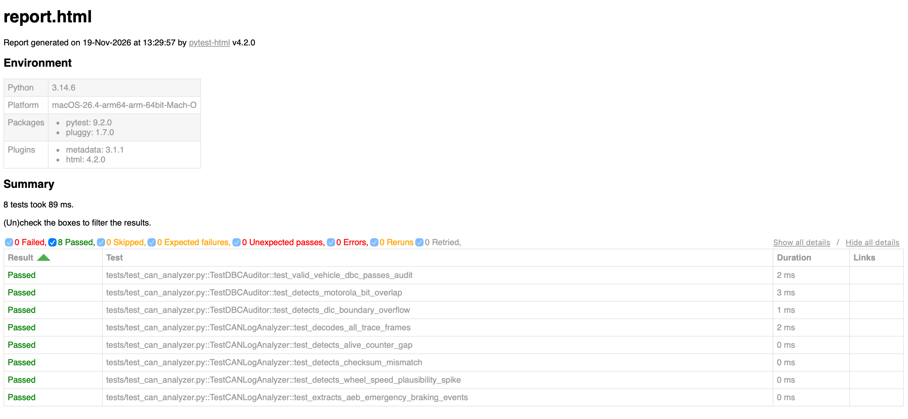

# Automotive CAN Bus Log Analyzer & DBC Static Auditor

A Python verification framework for validating **Vector CAN Database (`.dbc`)** definitions and analyzing recorded **CAN bus traces (`.asc`)** against End-to-End (E2E) safety and physical plausibility requirements.

## Verification Scope & Requirements
* **REQ-DBC-01 (Database Integrity & E2E Coverage):** Validates DBC message definitions and identifies frames protected by `COUNTER` and `CHECKSUM` signals.
* **REQ-DBC-02 (Bit-Layout Collision Detection):** Computes exact bit occupancy across both **Motorola (Big-Endian `@0`)** and **Intel (Little-Endian `@1`)** layouts to catch overlapping signal definitions.
* **REQ-DBC-03 (DLC Boundary Verification):** Flags signals whose bit length exceeds the frame's declared Data Length Code (`DLC * 8` bits).
* **REQ-LOG-01 (E2E Alive Counter Verification):** Tracks rolling frame counters (`mod 16` / `mod 256`) across bus traces to detect dropped or duplicated frames.
* **REQ-LOG-02 (E2E Checksum Verification):** Recomputes the 8-bit Toyota CAN checksum (`(ID_H + ID_L + DLC + sum(payload)) & 0xFF`) to detect bit-flip transmission corruption.
* **REQ-LOG-03 (Physical Plausibility Monitoring):** Monitors decoded `WHEEL_SPEEDS` signals (`km/h`) to flag unphysical acceleration spikes (`> 120 km/h/s`).
* **REQ-LOG-04 (ADAS / AEB Event Extraction):** Decodes `AEB_STATUS` frames to log `EMERGENCY_BRAKING` activations, `TARGET_TTC`, and hydraulic `PREFILL_ACTIVE` states.

## Project Structure
```text
can-log-analyzer/
╭─ .github/workflows/
│  ╰─ tests.yml             # GitHub Actions CI pipeline
├─ data/
│  ├─ toyota_prius.dbc      # Real-world vehicle DBC definition (openDBC)
│  ╰─ sample_drive.asc      # Recorded CAN bus trace with injected anomalies
├─ docs/
│  ╰─ test_report.png       # Pytest HTML execution report screenshot
├─ src/
│  ├─ __init__.py
│  ├─ dbc_auditor.py        # Static DBC validator (bit overlap, DLC & signal checks)
│  ╰─ log_analyzer.py       # CAN frame decoder & E2E safety verifier (CRC, Alive Counter)
├─ tests/
│  ╰─ test_can_analyzer.py  # Pytest suite (DBC audit, decoding, E2E & anomaly detection)
├─ .gitignore
├─ pytest.ini               # Default pytest & HTML report configuration
├─ requirements.txt         # Pinned dependencies
╰─ README.md

```

## Quick Start
Install dependencies and run the test suite (automatically generates `report.html`):

```bash
pip install -r requirements.txt
python -m pytest
```
## Verification Report

